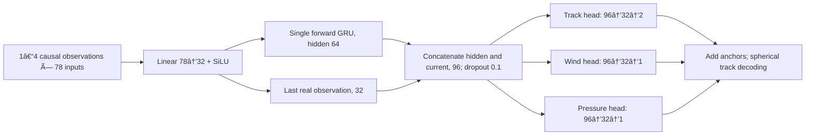

# Bay of Bengal Cyclone AI: initial modelling design

Design version 0.3.0 · 28 October 2026 · Dataset 2.0.0

**Decision:** start with a compact residual GRU for six-hour track and intensity prediction. Compare Bay-only training against NIO pretraining followed by Bay fine-tuning. Retain a snapshot neural control and a tree baseline. Add probabilistic heads only after the deterministic comparison works. This is an initial design, not a selected or scientifically validated model.

The executable deterministic runner and checks live in `modelling/`. The data-preparation archives and original handoff remain unchanged. No test observations have been decoded by the modelling code, and no test metrics or trained research checkpoint have been produced. Short acceptance checkpoints are implementation evidence only.

## 1. Task and claim boundary

At an existing cyclone observation time t, use states and predictors at times no later than t to predict position, maximum sustained wind and minimum pressure at t+6 hours. The task is conditioned on an already identified cyclone. It does not estimate cyclone genesis, disappearance or future occurrence frequency.

The first experiment is a **retrospective prediction experiment using best-track states and reanalysis predictors**. It cannot establish operational warning skill: source publication delays, retrospective best-track revisions and the exact temporal support of daily SST need an availability audit before an operational experiment. Copernicus describes ERA5 updates as several days behind real time, and NOAA describes daily OISST as using a day's observations. Same-date SST can therefore contain observations later than a 00 UTC forecast origin. This is an availability risk to investigate, not a demonstrated error in the package. [Copernicus reanalysis](https://climate.copernicus.eu/climate-reanalysis), [NOAA OISST](https://www.ncei.noaa.gov/products/optimum-interpolation-sst).

The portable package does not expose sufficient source construction detail to resolve all timing questions. The local `bob_cyclone_training_v1.ipynb` is an acceptance/smoke-test notebook; preserve or obtain the Fabric construction notebooks and extraction definitions before making stronger availability claims. An operational extension needs timestamped real-time cyclone analyses and operational atmospheric inputs, plus consistent latency-matched baselines. It would be a separate data release and evaluation.

No initial claim of architectural novelty, operational superiority, calibrated probabilities, administrative-state landfall prediction, rainfall, inundation, loss estimation or long-term climate projection is justified.

## 2. What the actual package permits

The following training and validation facts were checked directly. Test counts below are metadata from the supplied manifest; test rows remain sealed.

| Partition | Samples | Cyclones | Role |
|---|---:|---:|---|
| NIO training | 5,557 | 289 | Optional supervised pretraining |
| Bay training | 4,560 | 235 | Bay-only learning or fine-tuning |
| Bay validation | 854 | 50 | Model selection and later calibration |
| Bay test | 1,018 | 65, per handoff | Final evaluation after experiment freeze |

All 4,560 Bay training rows occur identically in NIO training. NIO adds **997 rows and 54 storms**, not 5,557 independent additional examples. NIO and Bay training share no cyclone with validation. Transfer learning is repeated supervised exposure plus broader basin coverage; its benefit must be measured against Bay-only and pooled-training controls.

The supplied feature statistics reproduce the corresponding training tables' means, sample standard deviations and valid counts. There are 39 physical/calendar/tendency features and four numerical labels, with no identifiers used as predictors.

Bay training has 2,342 observed current winds, 2,277 observed current pressures and 2,194 observed SST values. Wind and pressure targets are present on 2,334 and 2,267 rows respectively. Notably, **244 wind targets and 145 pressure targets are observed while the current value is missing**. Validation has 20 and 19 such cases. A residual model must retain these observed targets.

The complete four-step input context is available on 3,864/4,560 Bay training rows and 709/854 validation rows. Early cyclone rows must remain usable with shorter contexts. Sequence creation must not silently shrink or redefine the official evaluation population.

A geographic Bay subset uses the **current** position inside 5–25°N, 78–100°E, matching the existing acceptance notebook. Bay-affecting storm lifecycles include points outside that box, sometimes far outside it; always distinguish the full partition from this geographic subset.

## 3. Input representation and causal history

For each feature j, use the supplied training mean mu_j and standard deviation s_j:

```text
missing_j = 1 if x_j is unavailable, else 0
z_j = (x_j - mu_j) / s_j when observed; 0 otherwise
input = concatenate(z[39], missing[39])
```

This yields a fixed 78-dimensional input. Indicators for every feature keep the interface stable across NIO, Bay and later inference missingness; the original acceptance notebook used only seven indicators and 46 inputs. This is a modelling choice, not a change to the data package. Keep `SST_AVAILABLE` as supplied in addition to the explicit SST mask. An ablation may remove this redundant flag, with a newly recorded feature contract.

No backward fill, interpolation across future observations or label-based input reconstruction is allowed. Missing values are imputed only from training means. No validation/test values contribute to any fitted transform, residual scaling or fallback. Constant features use a scale of one.

Default history: four consecutive observations `[t-18h, t-12h, t-6h, t]`, predicting t+6h. This is 18 hours of observed history, not 24 hours. Group by SID and partition; sort by timestamp; stop at a missing six-hour interval or cyclone boundary. Use only exported input features, never preceding rows' targets as a source of historical features.

Keep one-, two- and three-observation starts. Right-pad within a batch, pack actual lengths into the GRU and gather the last real projected observation. Do not pass padding through as if it were measured weather. Every sequence is constructed independently from its own partition. Shuffling completed training windows is permitted; randomly repartitioning rows is not.

## 4. Target representation: learn corrections to a strong anchor

Track anchor, exactly matching the handoff's constant-velocity definition:

```text
lat_cv = current_lat + LAT_CHANGE_6H, with missing change replaced by 0
lon_cv = current_lon + LON_CHANGE_6H, with missing change replaced by 0
```

Map both the anchor and the true t+6 position to the tangent plane at the current cyclone centre using a spherical logarithmic map, with Earth radius 6371.0088 km. The map returns east and north components in kilometres. Learn the two-component difference between these mapped displacements. At prediction time, add the correction to the anchor vector and use the spherical exponential map to recover latitude/longitude. The implementation handles longitude wrapping and zero displacement; evaluation uses great-circle distance.

The accepted constant-velocity baseline is an extrapolation in latitude/longitude. Mapping it onto the sphere preserves that exact reference forecast; it does not turn it into a dynamically derived steering model.

Intensity anchor: observed current wind/pressure where available; otherwise the corresponding **training current-feature mean**. Learn future wind minus this anchor, in knots, and future pressure minus this anchor, in hPa. Preserve the input missingness indicators so the network can distinguish a measurement from a fallback. Never drop an observed future label because its current value is missing. Never impute a missing target.

Scale residuals using training-only root-mean-square magnitudes, with minimum scale 1 in each native unit. Use a common track scale `sqrt(mean(east_residual^2 and north_residual^2))` for rotationally consistent axis weighting, and separate wind/pressure scales. Do not subtract a residual mean: zero model output must reproduce the anchor. Save these scales and fallback means in the model artifact.

## 5. Default architecture



Each head uses SiLU between its two linear layers. Final head weights and biases start at zero. The output layers receive gradients on the first update; the encoder receives data gradients after those weights become nonzero. The architecture has **30,788 parameters**, recorded in `reports/design_checks.json`.

A forward GRU and packed sequences give a small, explicit causal history model; the current-feature skip path preserves access to local conditions. PyTorch supports packed variable-length input in its GRU. [GRU documentation](https://docs.pytorch.org/docs/stable/generated/torch.nn.GRU.html), [packed sequence documentation](https://docs.pytorch.org/docs/stable/generated/torch.nn.utils.rnn.pack_padded_sequence.html).

The candidate is intentionally small because the evidence base is hundreds of storms, with strongly correlated observations. A GRU is a hypothesis to test against simpler models, not an assumed winner. Comparative tabular research motivates keeping a tree control in the experiment. [Gorishniy et al., 2021](https://arxiv.org/abs/2106.11959).

## 6. Loss and optimization

Use SmoothL1 loss on scaled residuals. Average the two track-coordinate losses into one track task; independently average each observed intensity task over its valid labels. Then average the active track/wind/pressure tasks equally. A batch with no wind/pressure labels contributes no loss for that head. Index observed labels **before** calculating a loss, so NaN labels cannot contaminate gradients.

Initial settings, fixed before fitting:

| Setting | Initial value |
|---|---|
| Seeds | 17, 29, 43 |
| Batch size | 128 |
| Optimizer | AdamW |
| Weight decay | 0.0001 |
| Gradient norm clip | 1.0 |
| NIO pretraining | 30 fixed epochs, learning rate 0.001 |
| Bay-only training | At most 100 epochs, learning rate 0.001 |
| Bay fine-tuning | At most 100 epochs, learning rate 0.0003 |
| Bay early stopping | Patience 12; minimum composite-score improvement 0.001 |

Pretraining uses training rows only and ends at its fixed epoch count. Do not use official validation to repeatedly tune pretraining duration. Bay-only/fine-tuning checkpoint choice uses selection validation only. Record training and validation curves, label denominators, seeds, config and code hashes. Three seeds describe optimization variability; they do not create three independent datasets.

No hard pressure–wind relation, land-decay penalty, monotonic intensity constraint or centre-wind steering loss in v0. Agency conventions, missing intensity values and the absence of a signed coastal-distance/land-state contract make those assumptions unsafe to impose without evidence. Label outliers and 700 hPa humidity above 100% are diagnostic flags, not grounds for silently clipping the frozen data. The portable quality report does not contain all original physical-range thresholds.

## 7. Safe NIO-to-Bay transfer

Use the handoff's preferred NIO statistics during pretraining and Bay statistics during fine-tuning. A naive switch moves the pretrained network's input coordinate system.

Preserve the function by rebasing the first linear layer before fine-tuning. If its value weights are W, mask weights M and bias c, define:

```text
a = s_Bay / s_NIO
b = (mu_Bay - mu_NIO) / s_NIO
W_new = W_old * a
M_new = M_old - W_old * b
c_new = c_old + W_old @ b
```

Columnwise operations are used for W and M. The mask adjustment cancels the mean shift for unavailable features. This transformation is applied before SiLU and the GRU, with no other learned input transform preceding it. Reset the optimizer after rebasing; transferred Adam moments would be in the old parameterization.

Keep the **NIO-fitted output residual scales and intensity fallback means fixed** throughout transfer. Switching these anchors at the same time would change forecasts even with an exact input rebase. Bay-only models fit their own output codec on Bay training. Save both the stage input statistics and output codec; do not infer them later from a file name.

Tests check forecast invariance with nonzero output weights and actual missing inputs. Rebase is an implementation safeguard, not evidence that transfer improves skill.

## 8. Model selection, calibration and the sealed test

Keep the supplied Bay validation partition, but assign whole storms to distinct roles:

| Role | Input years | Rows | Storms | Permitted use |
|---|---|---:|---:|---|
| Selection | 2011–2014 | 493 | 25 | Checkpoint, model family and limited settings |
| Calibration | 2015–2017 | 361 | 25 | Fit uncertainty scale after the mean model is fixed |
| Final test | 2018–2025 | 1,018, metadata | 65, handoff | One final frozen experiment |

If a storm crosses the selection/calibration boundary, its entire lifecycle goes into the later role. `validation_roles.csv` records the assignment. The original 854-row validation benchmark was inspected for handoff acceptance and baseline reproduction; the later role is a prospective holdout from **learned model selection**, not a never-inspected archive. There are few independent calibration storms, so do not promise exact coverage guarantees.

Use the following primary **selection** score, with references calculated on the same selection rows:

```text
score = mean(
    model mean track error / constant-velocity mean track error,
    model wind MAE on persistence-eligible pairs / persistence wind MAE,
    model pressure MAE on persistence-eligible pairs / persistence pressure MAE
)
```

Pairing means current intensity, target intensity and each compared prediction all exist on exactly the same rows. Persistence has validation counts 627 wind/631 pressure, whereas available targets number 647/650. Report model results on **all observed labels** alongside these paired scores. Never compare a model MAE over 647 labels directly to a 627-label baseline and claim an improvement.

For each candidate, train all three seeds and use their mean selection score to choose a family/regime; retain each seed's score and checkpoint. Within a seed, the same score selects its epoch. Predeclare the deterministic final predictor as the mean of the selected family's three runs: average track displacements in the common current-centred tangent plane and intensity predictions in native units. Report ensemble and individual-seed validation scores. This is a small, declared selection procedure; do not add unlimited variants after seeing results. If no learned candidate reliably improves on the reference, retain the physical baseline and report that outcome.

All probabilistic mean/variance model choices use selection storms or training-internal folds, never the calibration role. Once those choices and weights are fixed, fit calibration parameters on the later role once. Do not retune architecture after inspecting its calibration performance.

Before final testing, record and hash feature order, transformations, validation roles, output codec, family, configuration, all seed checkpoints, ensemble rule, calibration parameters and metrics definitions. Implement a separate final-evaluation command tied to this freeze record. The current design loader refuses `bob_test` and provides no override. Raw archive checksums may read test bytes, but no test Parquet is decoded. Do not run test inference as an implementation check.

## 9. Initial comparison matrix

This initial comparison matrix is retained for reproducibility. The supplied Colab exports now contain the deterministic comparisons and the bounded wind-loss follow-up selecting the absolute-wind-loss MLP; see the current README and stage-specific guides.

| ID | Candidate | Training regime | What it resolves |
|---|---|---|---|
| B0 | Persistence | None | Intensity reference and stationary track reference |
| B1 | Constant velocity/tendency | None | Accepted motion reference |
| B2 | Residual histogram gradient boosting | Bay only | Whether snapshot tabular predictors suffice |
| N0 | Snapshot residual MLP, 78→64→32→4 | Bay only | Neural snapshot control without history |
| N1 | Residual GRU, four observations | Bay only | Incremental value of causal history |
| N2 | Same residual GRU | NIO pretrain → Bay fine-tune | Incremental value of broader basin training |
| N3 | Same residual GRU | Pooled NIO training, no fine-tune | Whether a two-stage schedule is needed |

For B2 use four separate `HistGradientBoostingRegressor` outputs, train-only encoded snapshot inputs, observed targets only, learning rate 0.05, 100 iterations, 7 leaves, minimum 30 samples/leaf, L2 1.0, `early_stopping=False` to avoid its random row holdout. Fit residuals in the same coordinate/anchor system. N0 uses the same masks, output contract and Bay training settings; calculate losses by task, even with a shared four-output layer.

N3 uses NIO preprocessing and its output codec throughout, with fixed 30 epochs and no Bay fine-tuning. N1/N2 are the core comparison. Report parameter count, optimization steps, row exposure and runtime because N2 has extra training. If claiming a transfer benefit, add a **budget-matched Bay-only** control with the same total update count, selecting its final-stage checkpoint on selection storms. Differences can otherwise reflect more optimization rather than additional basin information.

After selecting a small candidate set, use bounded ablations: history length 1 vs 4, environmental predictors removed, SST values/availability removed, and NIO transfer removed. Keep target/missingness masks and all split boundaries. Predeclare any reduced-feature normalization rebase consistently. These controls distinguish useful atmospheric signal from persistence, location, calendar and missingness patterns. They are not implemented in the initial prototype.

## 10. Probabilistic extension

The original design below is retained as context. The implemented first extension is [the frozen-ensemble uncertainty protocol](uncertainty.md): means stay fixed, one Gaussian is centered on the selected three-seed ensemble, and a separate spread MLP is trained. Full uncertainty research and one-time reserved-role calibration are now verified. The mean/variance joint training and mixture options below are not implemented.

Original proposal: start with a bivariate Gaussian for east/north track residuals and separate univariate Gaussian heads for wind and pressure residuals. Use positive standard deviations via `softplus + floor` and bounded track correlation `0.95 * tanh(raw_rho)`. A Cholesky parameterization is an alternative, not another initial search dimension. Keep the deterministic anchors and training scales.

Warm-start means from the selected deterministic model; initialize spread from training residual errors obtained without using calibration/test labels, preferably from chronological, storm-grouped out-of-fold predictions within training. If those are not yet available, use a fixed train-derived RMS initialization and label it as initialization only. Fit variance/mean heads with masked Gaussian NLL, task-normalized in the same way as the deterministic objective. PyTorch's scalar Gaussian loss takes variance, not standard deviation. [GaussianNLLLoss documentation](https://docs.pytorch.org/docs/stable/generated/torch.nn.GaussianNLLLoss.html).

Fit at most three positive post-hoc spread factors on calibration storms: one for the 2D track covariance and one each for wind/pressure. Scale track covariance by the square of its factor and marginal standard deviations by their factors. Keep means fixed. For the three-seed mixture, calibrate the predictive mixture distribution explicitly; do not pretend a mixture NLL equals the average member NLL. A simpler first probabilistic release can use one preselected seed, declared before calibration; it must be distinguished from the deterministic ensemble.

Report NLL in the declared residual/native-unit density convention, marginal CRPS, interval coverage and width at predeclared 50%, 80%, 90% levels, and joint track ellipse coverage/area. Marginal track-coordinate CRPS is not a spatial joint score; add energy score on sampled 2D displacements if evaluating the joint distribution. Convert covariance/scales consistently back to kilometres, knots and hPa. A mapped spherical track distribution is not a Gaussian density in latitude/longitude; do not report coordinate densities without the correct transformation.

Gaussian intensity assigns some probability to negative wind or implausible pressure. Measure/report that mass. Do not silently clip samples or intervals while retaining an unclipped likelihood. If unacceptable, replace the relevant likelihood with a declared positive/truncated alternative selected before calibration. A Gaussian is a first uncertainty model, not a guaranteed physically valid joint cyclone distribution. Separate intensity heads do not model wind–pressure dependence.

## 11. Evaluation and acceptance criteria

Reproduced full validation references:

| Model | Mean track, full (km) | Mean track, geographic Bay (km) | Wind MAE (kt), paired | Pressure MAE (hPa), paired |
|---|---:|---:|---:|---:|
| Persistence | 85.250652 | 77.358494 | 2.430622 | 1.494453 |
| Constant velocity/tendency | 39.040388 | 37.932483 | 2.992026 | 1.676704 |

Bay-only geographic intensity persistence references are 2.353261 kt on 552 eligible rows and 1.447273 hPa on 550 eligible rows. Exact reproduced numbers and sample counts are saved in the baseline JSON. Selection-only references are separate fields in the design-check report; do not substitute the full-validation thresholds in the selection score.

For learned candidates report track mean, median, p90 and per-axis error; observed-label wind/pressure MAE; paired baseline skill `1 - model_error / baseline_error`; and prediction/label counts. Report full partition and geographic Bay subset. Include storm-macro averages alongside row-weighted metrics, and paired confidence intervals by resampling **whole storms** with 2,000 bootstrap replicates and a recorded seed. Do not bootstrap individual six-hour rows as independent observations.

Subgroups use current observed intensity (with explicit unknown group), current position and current distance to land. Predeclare distance bands 0–50, >50–200, >200 km. Keep small groups descriptive and publish counts. The current package has no validated administrative-state landfall event labels. Distance-to-land is a proximity diagnostic, not a state landfall classifier.

A six-hour intensity label alone does not establish the standard 24-hour rapid-intensification event. Build audited continuous 24-hour labels within each partition before reporting RI event skill. Treat any six-hour change subgroup as a different diagnostic.

Deployment/final-test readiness requires reproducible baselines, all contract checks passing, selected learned model evaluation with uncertainty by storm, saved preprocessing/checkpoints, and frozen calibration. Passing a forward/backward smoke check alone satisfies none of the scientific skill criteria. Do not force a neural model into the final deliverable if the baselines remain stronger.

## 12. What is implemented now and what remains

Implemented: package/hash checks; guarded training/validation loading; train-stat verification; complete missingness encoding; causal variable-length windows; spherical track mapping; residual encoding and decoding; compact GRU and snapshot MLP; tree controls; masked deterministic loss; normalization rebase; exact baseline reproduction; role assignment; epoch training; selection-only early stopping; checkpoint/reload/resume; declared-seed ensembles; paired/all-observed metrics; storm bootstrap intervals; an exact-update-budget Bay control; persistent mirroring; a Colab notebook; and manifest-verified transfer/result archives.

The deterministic runner supports B2/N0/N1/N2/N3 through `bay_tree`, `bay_mlp`, `bay_gru`, `transfer_gru` and `pooled_gru`. `bay_budget --budget-updates N` performs exactly N Bay training updates and selects its terminal checkpoint; use each corresponding transfer seed's actual update count and record that relationship before attributing a gain to transfer. A nonzero update cap can end a shuffled training epoch early; this is logged explicitly.

The completed deterministic and wind follow-up exports select the absolute-wind-loss MLP. Full [frozen-mean uncertainty training and one-time calibration](uncertainty.md) are verified. The next runnable stage is the [reviewed final evaluator](final-evaluation.md); its default pass leaves the test sealed. Same-environment epoch-boundary training resume is tested for exact CPU equivalence. Changed training runtimes require an explicit flag and carry no exact-equivalence claim; the final evaluator instead binds the exact prepared runtime. Stage-specific commands are documented in the linked guides.
